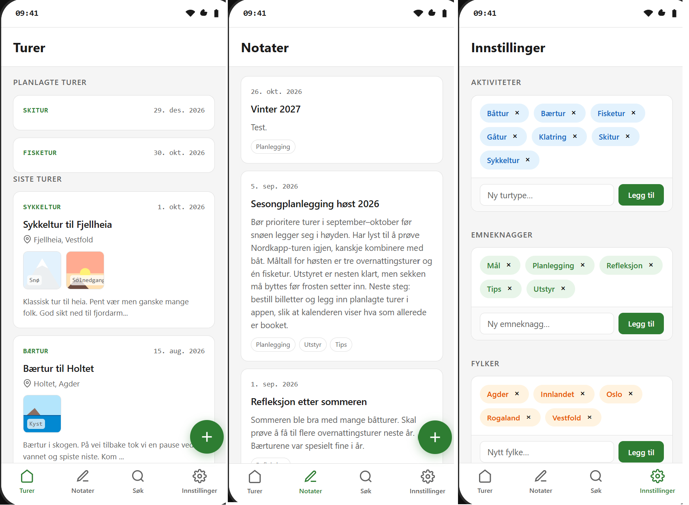
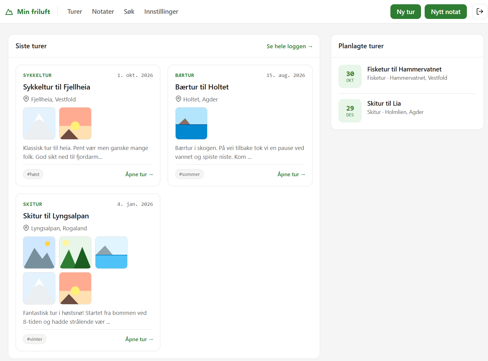

# Min Friluft

Demo-app for en friluftsdagbok hvor desktop- og mobil-versjonen benytter samme database. Bruker lagrer sine turopplevelser og relaterte notater.

| Utgave  | Fil                         | Beskrivelse                                       |
| ------- | --------------------------- | ------------------------------------------------- |
| Mobil   | `public/index.html`         | Kan installeres på hjemskjermen som en app (PWA). |
| Desktop | `public/index-desktop.html` | Laget for stor skjerm.                            |

## Tech stack

- **Node 22+** med **Express 5**
- **SQLite** via `better-sqlite3`
- **bcrypt** for passord hashing, sesjonscookie for innlogging
- **Vanilla JavaScript og CSS** i frontend
- **PWA** med `manifest.webmanifest` og service worker for installasjon på mobil
- **Tester**: `node:test` for API-et, **QUnit** for controllere,
  **Playwright** for end-to-end

## Arkitektur

```
public/            Frontend: ren JavaScript og CSS, ingen byggeprosess
  index.html         mobilutgaven
  index-desktop.html skrivebordsutgaven
  js/                api-klient, modell, og side-visninger/-kontrollere per side
  css/               style.css (mobil) og desktop.css
  sw.js              service worker: cacher statiske filer, aldri dataene
server/            Backend: Express 5 + SQLite
  src/app.js         bygger Express-appen
  src/routes/        auth, trips, images, notes, settings
  src/auth.js        sesjoner og cookie
  src/db.js          databasekobling og migreringer
db/                schema.sql og seed.sql
```

## Installasjon server

```bash
npm --prefix server install
npm run migrate                # oppretter og oppdaterer databasen
node server/scripts/create-user.js --email demo@eksempel.no --password hemmelig
npm start                      # starter både appen og API-et på http://127.0.0.1:3000
```

Sette opp bruker med demodata:

```bash
node server/scripts/import-demo.js --email demo@eksempel.no --password hemmelig
```

### NGINX eksempeloppsett

```nginx
# Velger mellom mobilutgaven og skrivebordsutgaven.
map $http_user_agent $mf_start {
    default                    index-desktop.html;
    ~*android|iphone|mobile    index.html;
}

server {
    listen 80;
    server_name <name>;
    return 301 https://<name>$request_uri;
}

server {
    listen 443 ssl;
    server_name <name>;

    root /var/www/<name>/public;

    access_log /var/log/nginx/<name>.access.log;
    error_log  /var/log/nginx/<name>.error.log;

    ssl_certificate /etc/letsencrypt/live/<name>/fullchain.pem;
    ssl_certificate_key /etc/letsencrypt/live/<name>/privkey.pem;

    location = / {
        try_files /$mf_start =404;
    }

    location /api/ {
        proxy_pass http://127.0.0.1:3000;
        proxy_set_header Host              $host;
        proxy_set_header X-Real-IP         $remote_addr;
        proxy_set_header X-Forwarded-For   $proxy_add_x_forwarded_for;
        proxy_set_header X-Forwarded-Proto $scheme;
    }


    location = /sw.js {
        add_header Cache-Control "no-cache";
    }

    location / {
        try_files $uri $uri/ =404;
    }
}
```

## Tester

| Kommando             | Hva den tester                                                         |
| -------------------- | ---------------------------------------------------------------------- |
| `npm test`           | API-et: turer, bilder, notater, innstillinger, scoping og kaskader     |
| `npm run test:e2e`   | begge utgavene og QUnit-testene i en ekte nettleser mot en ekte server |
| `/public/tests.html` | tester controller-logikken i mobilutgaven (QUnit)                      |

**API-testene** starter en ekte server mot en egen database i en
midlertidig mappe.

**End-to-end-testene** bruker Playwright. De starter selv en server med
demodata i en midlertidig database, og går gjennom appen slik en bruker
gjør det: logger inn, lager en tur, og sjekker at den ligger der etter en
omlasting. `e2e/qunit.spec.js` kjører QUnit-testene i samme kjøring, og
`e2e/pwa.spec.js` sjekker at appen er installerbar og at dataene ikke
ligger i cache.

```bash
npm install -D @playwright/test   # én gang
npm run test:e2e
```

**QUnit-testene** ligger i `../public/test/controllerTests.js` og kjøres
i nettleseren: åpne `../public/tests.html`. De bruker en falsk API
(`../public/test/apiStub.js`), så de trenger ingen server.

## Mobil



## Desktop


